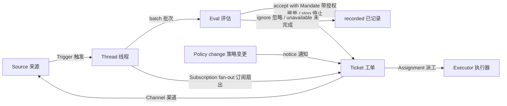

# 001 领域模型

本文命名 dsh-superagent 的概念，以及每个概念遵守的规则。代码、智能体调用的工具、面板和其他文档都只用这些术语，不用别的。遵循 [000 设计理念](000-philosophy.md)，模型里只保留工作真正需要的概念，一个业务需求会变成其中某个概念的属性。

## 流程

工作从触发走到评估，再到执行。来源产出触发。触发以"上下文"的形式扇出给订阅了它所在线程的工单。这样到达某张工单的某个人发来的消息，就留在那张工单上；其他触发都进入评估，由评估判断它是否在要求新工作。评估接单时，创建一张带授权的工单。派工把工单交给执行器，结果再经渠道回到来源。

## 概念

来源、线程、评估、授权与订阅构成核心领域，其余概念支撑它们。

| 概念 | 定义 | 遵守的规则 | 为什么存在 |
| --- | --- | --- | --- |
| Source 来源 | 一条事件流。来源"种类"是可复用的实现；来源"实例"是某个种类的一份配置：它是否运行、监听什么 | 保存自己的读取位置和自己的机器人身份。定义什么算一个事件，包括只在时间上成立的条件。在进入领域之前，先丢掉机器人自己的消息和它不监听范围内的触发。把每个触发翻译成它所属的线程以及回复用的渠道地址 | 重启不能重放事件 |
| Trigger 触发 | 一个不可变的事件，带来源自己的元数据，例如它的发起者 | 属于一个或多个线程。同一个触发被接单两次只创建一张工单 | 审计与幂等的单位 |
| Thread 线程 | 按时间排列的触发；由来源定义哪些触发组成同一个线程 | 同一时刻最多一个评估在它上面运行。它可以有多张工单。它持有自己的订阅、正在运行的评估和决定历史 | 给评估一致的视图和上下文 |
| Correlation 关联 | 同一个触发所属的线程之间的关系 | 只添加上下文，从不路由 | 让评估能顺藤摸瓜找相关证据 |
| Channel 渠道 | 线程的写入侧；由来源定义它的地址 | 一个线程可以有多个渠道；一张工单持有一组渠道 | 确认、回复、pull request、评审处理结果都是写入 |
| Policy 策略 | 带版本的评估规则，以及每个来源的那一部分：谁能通过这个来源发起工作、用该来源自己的身份、名单如何同步、哪些机器人可以提出候选 | 策略版本覆盖规则、接单模式和来源各部分。影响在跑工单的变更（例如它据以接单的某条规则发生了变化）会送达它的派工，但不会收回授权。不同来源上的身份永不互相映射 | 规则变了，正在跑的评估必须作废 |
| Eval 评估 | 对一批触发的判断，分两层：准入与研判 | 输入：触发批次、线程快照、该线程上的所有工单（含已结束的）、当前策略。输出：一个决定。不持有状态 | 决定新工作是开始、继续还是停止 |
| Mandate 授权 | 接单所授予的东西：策略版本、范围、强度、命中的规则、发送者在该来源上的身份、以及来源是怎样收到这个触发的 | 不可变；更大的范围意味着一张新工单。工单结束并不终止它：只有人明确停止才撤回，策略不再支撑它则吊销。已结束的工单恢复之前，要对照当前策略重新校验 | 说明这项工作凭什么可以做、能做多远 |
| Ticket 工单 | 一份已获授权的工作 | 只有评估能创建。引用它的授权；持有它的渠道与输入。状态从 open → ended，当人在它某个线程上发消息时可以回到 open，除非有人已把它停止。它定义自己的状态，而不跟随执行器的状态 | 拥有执行过程及其报告 |
| Assignment 派工 | 一张工单与一个执行器实例的绑定 | 一张工单随时间会有多个派工。状态 pending → running → ended，与工单相互独立。只有它的最终报告才能让工单在执行器一侧结束 | 执行器在领域之外，但"谁在执行"必须在领域之内 |
| Subscription 订阅 | 工单与线程之间的多对多关系，由线程持有 | 匹配的触发会扇出到所有存活的已订阅工单，不检查是谁发的；这样到达工单的人的消息不经过评估。执行器为上下文而跟随的线程以同样方式到达它的工单，但不提供任何权限，也不会恢复工单。已结束的工单保留它的订阅，包括已关闭或已合并的 pull request 的那条：人的消息会让它在同一授权下恢复，不经评估或决定；机器人和 CI 的消息到不了它，因为它的执行器恢复时会重新读取它的线程。被停止的工单什么都收不到。主 Session 只有在消息明确指向某张工单时，才把线程挂到那张已有工单上。人可以丢掉某个线程上的全部订阅；执行器只能丢掉自己工单对某个它认为无关的线程的订阅，例外是工单开始时所在的那个线程，以及来源让它跟随的线程（例如它自己的 pull request） | 后续讨论不必再 @ 一次智能体就能到达执行器 |

人不是领域概念。触发带着发起者的标识符，形式由来源给定。允许名单是策略中某个来源的那一部分，用该来源的身份。同一个人在多个来源上都有账号这件事，是提示词文本，智能体需要时去读。

执行器及其 Session 与目录在领域之外，通过派工接入。

聚合：来源持有它的读取位置。线程持有它的订阅、正在运行的评估（串行执行，期间到达的触发并入下一批）以及它的决定历史。工单持有它的派工、渠道与输入，并按 id 引用决定。

## 被否决的概念

| 被否决 | 理由 |
| --- | --- |
| 把 Principal 或 Membership 当作实体，或跨来源映射身份 | 人是触发的元数据；允许名单是策略中来源的一部分；跨来源对应关系是提示词文本 |
| 让评估自己排程延后的触发 | 需要等待的条件就是一个普通来源，评估于是永远不反向依赖来源 |
| 等待中、已吊销的评估状态 | 等待属于来源；评估超时就把触发重新入队，或者以 `unavailable` 结束 |
| 每个线程最多一张存活工单 | 一个线程可以承载几件彼此独立的工作；研判靠工单列表来避免重复 |
| "追加到工单"的决定 | 追加就是订阅扇出，不需要评估 |
| 对订阅做准入检查 | 订阅覆盖整个线程；授权把"权限"与"上下文"分开 |
| 会路由的关联 | 路由由订阅负责，关联只添加上下文 |
| 跟随 DSH Session 的工单状态 | 工单可以被移交、被恢复、由多个执行器运行，所以它自己定义状态 |
| 由执行器声明"有人叫它停" | 只有评估能决定结束的强度 |
| 策略变更时取消正在跑的工单 | 半路取消会留下做了一半的工作，改为记录变更并送达 |
| 执行器 Session 失败或受阻时锁死它的所有工具 | 那会拒绝人在该 Session 里直接工作，也拒绝恢复后的报告；暂停自动输入就够了 |
| 从报告的自由文本里推断"在等人" | 分类需要结构化事实；执行器通过结构化字段来问 |

## 什么是可复用的

上面的概念及其规则可复用。来源的各种实现、策略内容、执行器与渠道的各种实现属于某个具体部署。每个来源在内部保留自己的说法，例如消息、会话或通知，然后再翻译成触发。

| 部分 | 在本仓库里 |
| --- | --- |
| Source 来源 | 飞书：实时事件、历史回溯、对已订阅话题的轮询。GitHub：通知、已订阅的 Issue 与 pull request、CI 变化、已合并或关闭的 pull request，以及（开启时）仓库内每个新 Issue、pull request、评论和默认分支的 CI |
| Policy 策略 | 评估规则，以及每个来源的允许名单、同步方式、机器人名单和准入表 |
| Executor 执行器 | 每张工单一个 DSH 执行器 Session 和一个目录，位于由执行器和各来源注册变量的执行环境中 |
| Channel 渠道 | 飞书话题回复、GitHub 评论、评审线程回复 |

## 术语表

本文与后续文档所用术语的对照表；后续文档会解释上面尚未介绍的术语。面板一次只显示一种语言；它的 (?) 按钮会以双语打开这份术语表。智能体在 GitHub 和飞书上发给人的消息用日常语言，不使用这些术语。

| 术语 | 中文 | 含义 |
| --- | --- | --- |
| Agent | 智能体 | dsh-superagent 运行的自动化团队成员，通过 GitHub 账号、飞书机器人等身份在来源上行动 |
| Main Session | 主 Session | 评估触发、接单并派发工单、并负责回复的 DSH Session；在代码与提示词里叫 `orchestrator` |
| Executor Session | 执行器 Session | 执行器为一张工单运行的 DSH Session；在代码与提示词里叫 `worker` |
| Source | 来源 | 一条事件流：由插件提供的一个种类，加上一份实例配置 |
| Trigger | 触发 | 来自来源的一个不可变事件 |
| Thread | 线程 | 按时间排列的触发；评估在它之内一次跑一个 |
| Correlation | 关联 | 共享同一个触发的线程之间的关系；只添加上下文 |
| Channel | 渠道 | 线程的写入侧 |
| Policy | 策略 | 带版本的接单规则，以及每个来源的那一部分，例如在那里谁可以要活干 |
| Policy version | 策略版本 | 某一组规则、来源各部分与接单模式的组合的标识；每个授权都记录它 |
| Eval | 评估 | 把一批触发变成一个决定的过程 |
| Gate | 准入 | 评估的第一层，确定性判断：谁可以发起工作、以什么强度 |
| Assessment | 研判 | 评估过程中模型的判断 |
| Decision | 决定 | 评估的结果 |
| Mandate | 授权 | 接单所授予的东西：强度、范围、以及它所依据的策略版本 |
| Ticket | 工单 | 一份已获授权的工作 |
| Assignment | 派工 | 一张工单与一个执行器实例的绑定 |
| Subscription | 订阅 | 一张工单与一个线程之间的关系 |
| Fan-out | 扇出 | 把已订阅线程的触发作为上下文送达工单 |
| Executor | 执行器 | 运行派工的端口：每张工单一个执行器 Session 和一个目录 |
| Execution environment | 执行环境 | 执行器 Session 与 prepare 命令运行的地方：由执行器和各来源注册的变量，每个都有键、值和说明 |
| Report | 报告 | 派工向它的工单汇报的状态 |
| Attention | 待人工决定 | 工单上等待人回答的问题 |
| Disposition | 去向 | 某个触发被过滤、被评估或被扇出的记录 |
| Input | 输入 | 送达工单的上下文：扇出的触发、策略变更、恢复和文本 |
| Scope | 范围 | 一个授权所允许的工作 |
| Strength | 强度 | 一个授权或一次评估的依据有多强 |

| 组 | 取值 |
| --- | --- |
| Decision 决定 | accept 接单 · stop 停止 · ignore 忽略 · unavailable 未完成 |
| Strength 强度 | explicit 明确 · inferred 推断 |
| Assignment 派工 | pending 待启动 · running 执行中 · ended 已结束 |
| Report 报告 | progress 进展 · waiting 等待 · ready 就绪 · blocked 受阻 · failed 失败 · dropped 无需处理 |
