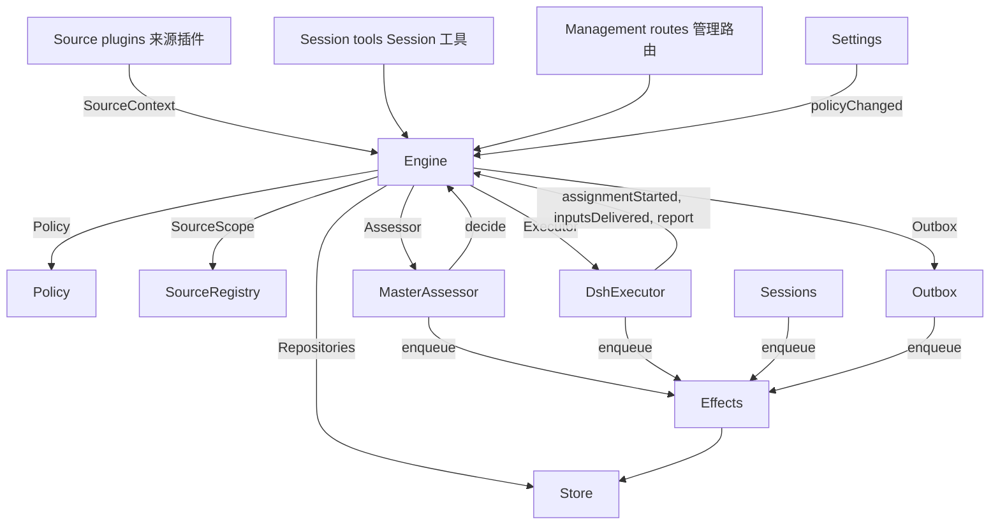

# 007 架构

这是实现部分的开发者指南。它把 [001 领域模型](001-domain.md) 到 [006 部署](006-deployment.md) 里的概念对应到类、接口和文件。先读运行时与 Engine，再把模块表和测试表当作代码索引。

## 核心类与胶水层

核心类在小接口背后拥有领域概念和外部边界。胶水层把工具参数、HTTP 请求、来源负载和 DeepSeek-Harness 事件翻译成对这些类的调用，再把结果变成卡片、视图和消息。

`Runtime`（`src/app/runtime.ts`）构造应用、提供依赖，并负责启动与关闭。`Engine` 自己构造内部的各个部分。执行器和研判器会回调 Engine，所以 Runtime 给它们 getter，而不要求按无环顺序构造。

### Runtime

`Runtime` 是组合根，不含领域规则。它的构造函数锁住状态目录、打开 Store，并构造每个组件。构造失败时，它关闭 Store 并释放锁。

启动时注册管理路由并执行 setup。setup 完成后，它安装 Session 与执行器钩子、确保主 Session 存在、启动策略同步、恢复被中断的派工、启动轮次与效应。`ready` 标记启动完成。

关闭时取消轮次、等待轮次、效应和智能体结束、恢复进程环境、关闭 Store 并释放锁。来源插件通过窄接口 `SourceHost`，把 Runtime 作为 `orchestrator` 服务注入。

| 部分 | 模块 | 做什么 |
| --- | --- | --- |
| Setup | `src/app/setup.ts` | 按工作节点 shell 的方式探测 CLI，解析出仓库和账号；写入并应用工作节点的环境和命令 shim；保留设置问题。设置改动账号时通过它检查，重启也通过它完成，重启会重新执行 setup |
| Passes | `src/app/passes.ts` | 一次只跑一轮，每两秒一次、或任何命令请求时也跑：先跑到期的效应，再跑 `Engine.evaluateDue`；来源的触发经由它到达 Engine |
| Outbox | `src/app/outbox.ts` | Engine 的 `Outbox` 端口，也是回执的唯一写入者：`send` 在一个事务里保存消息的回执并排队它的 `reply` 效应，效应的处理器通过 `SourceRegistry.send` 发出消息；来源关闭时消息等待，会话已消失或未被监听时丢弃 |
| Notices | `src/app/notices.ts` | 把领域事件和工作节点活动转成主 Session 消息。`eventNotice` 处理领域通知；`reportRelay` 立即转发问题、把普通进展留在工单上、转发其他报告；`followupRelay` 指出拥有人工跟进的那些工单。在一轮进行中到达的转发，经 DeepSeek-Harness 的 inbox 在该轮的下一个步骤一起投递 |

### Engine

`Engine`（`src/core/engine.ts`）是触发、线程、决定、工单和派工的唯一写入者。它从 `src/core/ports.ts` 接收这些端口：`Repositories`、策略取值器、`SourceScope`、`Assessor`、`Executor` 和 `Outbox`。可选依赖是 `prepareTicket`、`now` 和 `emit`。

Engine 的所有方法都是同步的。每个命令在一个事务里改动它的聚合。`evaluateDue` 对每个它改动的评估或工单各用一个事务。端口在事务内排队外部工作；适配器在提交后执行它。非法请求抛 `UserError`。

Engine 只有一个入口，再委派给五个内部部分。它拥有每个命令的事务。跨部分的命令（如 `attach`、`evaluateDue`、`policyChanged`）按顺序调用各部分。

每个部分继承 `EnginePart`（`src/core/part.ts`），它提供选项和共享读取。各部分之间的依赖是单向的：

| 部分 | 职责 | 依赖 |
| --- | --- | --- |
| `Intake` | 来源的触发：连同去向存储一次，记到它的线程及其关联上，扇出到订阅的工单；除开"某人的消息已经到达某个工单"的情况，还要在它的主线程上排队评估 | Tickets |
| `Evals` | 线程的评估：批处理；准入的强度、行动者和依据，以及给出它们的触发（`primary`）；截止时间取自候选的投递时刻并随暂停平移；过期评估的重新排队；候选、重放与交回；策略变化时的重新排队；以及每个评估最终得到的决定：接单、停止、忽略或未完成 | Tickets |
| `Tickets` | 工单生命周期：从接单创建工单及其授权、订阅和首个派工；它跟随的线程及它们的关闭（`followsDone`）；附加线程与仅为上下文而跟随的线程；输入与备注；恢复以及恢复会拒绝的消息；重试、重启、停止与结束；被丢弃的订阅；以及把策略变化通知到受影响的工单 | Replies |
| `Assignments` | 执行器及其工作节点上报的内容：派工已开始；输入已到达或投递失败；重启中断了派工；以及工作节点的报告及其对人的提问 | Tickets、Replies |
| `Replies` | 通过 `Outbox` 写渠道：确认、答复、结果和待人工决定消息，各自按允许它发出的规则 | 无 |

命令用祈使式命名，例如 `stopTicket`；适配器上报的事实用心过去式命名，例如 `assignmentStarted`。查询 `candidate` 用名词。

调用方只拿到自己角色的 `Pick`：`EngineForSources`、`EngineForMainSession`、`EngineForPeople`、`EngineForSettings` 或 `EngineForExecutor`。

| 角色 | 方法 | 作用 |
| --- | --- | --- |
| 来源 | `receive(trigger)` | 把触发存一次，并回答 `stored`、`duplicate`，或没有任何来源接收时的 `filtered`；把它扇出到订阅了相关线程的工单（除非处理被暂停，某人的消息会立即恢复已结束的工单）；并在它的主线程上排队评估，除非这是已经到达某个工单的人的消息，那就仍归该工单 |
| 来源 | `bindThread(ticketId, thread, own)` | 让一张未结束的工单跟随来源的某个线程（例如某个 pull request 的线程），`own` 表示这张工单开启了它；已关闭的线程被再次绑定时重新视为未关闭。结束工单的是线程的关闭，而不是 `ready` 报告 |
| 来源 | `threadClosed(thread, outcome, at)` | 某线程已关闭：每个跟随它的未结束工单都记下这次关闭，并在它跟随的线程都了结之后结束（`followsDone`）：它开启的线程都已关闭，或者它没开启任何线程而它跟随的线程全部关闭。结束去向为 `merged` 或 `closed`，取最近这次关闭的结果；例外是：关闭之后恢复的工作尚未报告 `ready`，或它的执行器在最近一次非 `progress` 的报告之后，通过确认或答复接手了某人的跟进，或最后一轮已结束；这时一个 `dropped` 报告才按关闭结果结束它 |
| 主 Session | `candidate(triggerId)` | 持有该触发的评估，按研判器的视角返回 |
| 主 Session | `candidateDelivered(evalId)` | 该评估的候选已到达主 Session：截止时间从现在开始算 |
| 主 Session | `decide(triggerId, outcome)` | 记录评估决定，或对明确请求记录直接决定。接单会原子地创建工单、授权、派工、订阅和确认。从卡片上忽略推断候选时，先记录 `ignoredFromCard`，再记录给出的理由。`followupOwners` 仍拥有人工跟进时，只允许停止 |
| 主 Session | `attach(ticketId, triggerId, note?)` | 把触发路由给某张工单，由它的执行器把该触发当作跟进决定；同时结束持有它的评估，该评估的其他触发等待新的评估。已结束的工单在它的授权下立即恢复，除非处理被暂停。执行器仍在决定的跟进会被拒绝，路由回交回它的那张工单也会被拒绝 |
| 主 Session | `requestStatus(ticketId)` | 向等待中的执行器 Session 询问状态，并回答是否问了 |
| 主 Session | `note(ticketId, text)` | 把别的工作里的事实作为文本输入给工单的执行器，这不授予任何权限 |
| 主 Session、执行器 | `reply(request)` | 为用途所指的渠道排队消息：`acknowledgement`、`answer`、`result` 或 `attention` |
| 人 | `stopTicket(ticketId, reason?)` | 人的停止，会撤回授权 |
| 人 | `retryTicket(ticketId)` | 结束停在人等处的派工（该工单在 `failed` 或 `blocked` 报告之后等待，或它的输入投递失败，`canRetry`），并启动新的派工 |
| 人 | `reevaluate(triggerId)` | 把已存储的触发排队做新的评估 |
| 人 | `unsubscribe(thread)` | 丢弃某个线程上的所有订阅，跟随它的工单不再跟随它；各自继续决定在那里收到的跟进 |
| 人 | `dismiss(decisionId)` | 忽略 `unavailable` 决定所显示的问题，决定里会有记录 |
| 执行器 | `assignmentStarted(ticketId, assignmentId)` | 派工开始运行；它等待中的输入发出去 |
| 执行器 | `inputsDelivered(ticketId, assignmentId, inputIds)` | 输入到达派工的执行器 Session，在那里各自等待某个步骤取用 |
| 执行器 | `inputsRead(ticketId, inputIds)` | 执行器 Session 把携带这些输入的消息纳入历史（一个 `user/message` Session 事件），模型从此看到它们；此前已认领但被取消或失败的步骤不算。报告或一轮结束之后即算已读，重启之后也一样，工单结束也不会取消；在记录已读之前投递的输入，只要其投递之后有报告或一轮结束，也算已读 |
| 执行器 | `turnEnded(ticketId, assignmentId)` | 执行器 Session 的一轮已结束，报告之后也一样；此时它既没有后台在跑，也没有移交给某人。之前某个步骤取用的内容算已读（`inputsRead`） |
| 执行器 | `deliveryFailed(ticketId, assignmentId, error)` | 输入投递失败；工单一直显示，直到某次投递成功、新派工开始或工单结束 |
| 执行器 | `report(ticketId, report)` | 记录报告及其对人的提问；`dropped` 结束工单，`ready` 完成不跟随任何线程的工单，并按线程的结束方式结束已了结其所跟线程的工单 |
| 执行器 | `markUnrelated(ticketId, thread, reason)` | 只丢弃该工单对某个附加线程的订阅（它认为该线程无关），带理由交回那里由该工单决定的跟进 |
| 执行器 | `followForContext(ticketId, thread)` | 让未结束的工单订阅相关线程以取上下文：消息会到达工单，但不给跟进强度，也不恢复工单 |
| 执行器 | `handback(ticketId, triggerId, reason)` | 记录工单交回某个到达它的触发，理由随候选携带；若此前是这张工单在决定它、且再没有别的工单决定它，则排队做新评估。回答是否已排队。每张工单对每个触发只交回一次，并保留其订阅 |
| 执行器 | `assignmentInterrupted(ticketId, assignmentId)` | 宿主停止时正在运行的派工：工作中途被中断，或在最近一次报告之后收到输入的，会带着恢复说明和"其执行器 Session 未取用、但已投递给它的输入"重新开始，做法与重试相同；此后已报告过的派工保留它的 Session。DshExecutor 在启动时逐个上报（`resume`），最早的工单在前，并重新排队那些还在等待的启动 |
| 轮次 | `evaluateDue()` | 除非处理被暂停：启动那些排队触发仍在等待的线程的评估，每个线程一个，其间排队的触发作为一个批次；让超过截止时间的评估的触发再排队，连续两次，第三次记录为 `unavailable`；并恢复暂停期间某人的消息到达过的已结束工单，前提是它们的授权仍成立。候选尚未到达主 Session 的评估不会过期。处理暂停期间没有评估过期，恢复后每个截止时间都往后平移暂停的时长 |
| 设置 | `policyChanged(from, to, effects)` | 告诉每个受影响的在线工单变化在哪方面影响它（`src/policy.ts` 的 `policyEffects`：它据以被接单的规则变了或不再适用、它的请求人可能不再能发起工作、或主动工作不再被接单），并在新版本下重启进行中的评估 |

Engine 把批处理、授权、扇出、恢复和待人工决定的规则保持为私有。几个共享谓词让这些规则保持一致：

- `waitsForPerson`（`src/core/model.ts`）：最近的派工报告了 `blocked` 或 `failed`，并且此后没有人的消息到达。为真时，自动输入和失败的启动都继续搁置。
- `followupOwners`：仍对自己线程上收到的人工跟进负责的工单。工单可以是在线的，也可以是未经人的停止而已结束、等待恢复的。交回该消息即终结这份责任。
- `settled`：某个决定已解决该请求；停止、未完成、已路由和拒绝停止的决定不算。
- `ticketStage`（`src/core/stage.ts`）：实现 [003 执行](003-execution.md) 里的阶段表。

工单结束时，未读的跟进回到评估，除非另一张工单仍拥有它们，或已有别的去向解决了它们。已确认、已答复和已交回的消息不计入。对没有确认去向的旧记录，由 outbox 回执提供这个事实。最终报告也覆盖派工开始时就已等待的消息，包括恢复它的那条消息。停止工单的那条消息不会被自动重新评估。

改动之后，Engine 从 `src/core/ports.ts` 的 `DomainEvents` 发出事件：

`trigger.received`、`eval.started`、`decision.recorded`、`ticket.created`、`ticket.resumed`、`ticket.ended`、`assignment.started`、`assignment.ended`、`thread.subscribed`、`thread.unsubscribed`、`trigger.requeued` 或 `policy.changed`。

Runtime 把 `ticket.ended`、`trigger.requeued` 和 `thread.unsubscribed` 变成通知。到达工单的人发 `trigger.received` 会变成跟进转发。工单以 merged 或 closed 结束时，`pullEndNotices` 用稳定的 id 发一条会话通知。目前其他事件没有消费者。

### 模型

`src/core/model.ts` 存放领域类型，`src/core/stage.ts` 存放工单阶段。决定用 `reason` 记录原因，它是一个 `Reason` 列表（`src/core/reasons.ts`）：每个 `Reason` 有一个 `code` 和它的 `values`，对批次里的某个触发还有它的 `triggerId`。

核心的代码（如 `timeout`、`policyChanged`、`routed`、`startedTicket`）在 `REASONS` 里，带有智能体通过 `reasonText` 读到的英文；准入或来源范围给出自己的代码，例如 `not_a_member`；`said` 携带研判器或某人写下的话。面板用 `reason.<code>` 给每个代码措辞，被来源过滤的触发也以同样方式记录来源的代码。

工单对每个事实只存一次。它没有 `ended` 时是未结束的，`ended` 记录何时、由谁、为何、以什么去向结束；它最近说的话就是最新的派工报告（`latestReport`）；它的执行器 Session 以它命名（`src/executor/dsh.ts` 的 `workerSessionId`）。

它的字段都有类型：`origin`，即给出其评估批次强度的可受理触发，以及该批次本身（`triggerId`、`triggerIds`）；`execution`，执行器选定的事项（`name`、`directory`、`assignment`）；`delivery`，最后一次失败的输入投递（`error`、`at`），直到某次投递成功、新派工开始或工单结束；`follows`，来源让它跟随的线程，每个是 `{thread, own, closed?}`：工单开启了它则为 `own`，关闭后带 `at` 与 `outcome`。只有 Tickets 部分写 `follows`；GitHub 来源用 `pullsOf` 和 `pullOf`（`src/sources/github-pull.ts`）读取它的 pull request。

携带触发的输入会记录它是否由人所写，`waitsForPerson` 读它。线程还在 `context` 里列出仅为其上下文而跟随它的订阅工单，在 `expired` 里统计其排队触发的评估连续过期的次数；评估记录它的 `primary` 触发以及候选被 `delivered` 的时间。

触发的去向记录它到达的工单（以扇出或附加方式）、某人的重新排队、每张交回它的工单及其理由，以及其执行器确认或答复过它的工单。

授权的 `basis`（`MandateBasis`）记录准入如何受理了它的触发。重新校验读取接收方的 `source`、`scope` 和 `row`、名单上的 `sender`、匹配的 `rules`，以及 `via`：

| `via` | 受理依据 |
| --- | --- |
| `addressed` | 允许的发送者 @ 了智能体 |
| `followup` | 消息到达了有工单的线程 |
| `admission` | 准入表格的一格；`observation` 标记推断出的候选 |
| `bot` | 名单上的机器人产生了推断候选 |

触发和线程的 `meta` 归来源所有，核心不解释它们。

### 策略

`src/policy.ts` 定义设置 schema、授权与研判规则。`settingsPolicy(settings, scope)` 每次使用时返回一个全新、无状态的 `Policy`：

- `version`、`paused` 和 `evalTimeoutMs` 描述它当前的状态。
- `gate(trigger, thread, tickets)` 返回受理强度和依据。
- `revalidate(mandate)` 检查既有授权是否仍成立。
- `admitsInferred(rules)` 只有在 auto 模式且匹配规则启用时允许主动接单。

`assessmentOutcome(assessment, settings, strength)` 把模型的研判转换为 Engine 的去向。它要求每条启用的规则都有判断、方向已定、有匹配的规则、以及意图证据。非 auto 模式下，推断出的接单变成一条"本来会接单"的记录。

`policyEffects(tickets, old, now, scope)` 找出变化影响哪些未结束的工单以及如何影响。`Engine.policyChanged` 只通知这些工单。`policyVersion` 对规则、接单模式和来源的策略部分（含机器人名单）做哈希。

### Store

`Store`（`src/app/store.ts`）拥有一个 SQLite 数据库。Runtime 在打开它之前先取得目录锁，防止第二个进程迁移或写入同一份状态。

它的接口按用途分组：

- **领域仓储：** `atomic`，以及 `triggers`、`threads`、`tickets`、`decisions`，各自有 `get`、`save` 和列表查询。带索引的工作集是 `threads.active()`、`tickets.open()`、`tickets.active()` 和 `read.subscribedThreads`。
- **读查询：** `read` 通过 `threadTriggers`、`triggerStats`、`search`、`droppedReplies` 等方法服务视图、工具和来源轮询。这些方法从不写。
- **来源元数据：** `threads.describe` 和 `threads.patchMeta` 更新来源拥有的线程元数据。
- **设置：** `settings`、`saveSettings`、`blockRevision`、`settingsHistory`。设置和提示词使用编号的 `Versions`（`src/app/versions.ts`）。
- **Outbox 回执：** `replyStatus` 和 `receipts`，只由 Outbox 写入。回执操作有 `get`、`waiting`、`behind`、`add`、`settle`、`withdraw`。`behind` 检查同一工单、同一会话的更早消息是否还在等待且失败少于三次。撤回的消息以 `channelGone` 或 `channelIgnored` 了结。读查询通过 `failingReplies`、`droppedReplies` 和 `droppedSince` 暴露失败与丢弃的回复。
- **带类型的键值记录：** `get`、`set`、`delete` 和 `keys`，条目来自 `KV`。

`afterCommit` 只在事务提交后执行动作，回滚后从不执行。Runtime 按存储的形状读记录；schema 11 迁移在启动时转换较旧的受支持记录。

### 效应

`Effects`（`src/app/effects.ts`）是持久化的副作用队列。命令在它的事务里调用 `enqueue(kind, key, payload)`；只有提交之后才开始执行。

每个 kind/key 对只有一行。重新排队同一个等待中的键会替换其负载并让它立即到期，但不改变队列顺序。`handle(kind, run, options)` 每种 kind 注册一个处理器。它按最旧优先处理到期行，直到并发上限。

失败按指数退避重试。抛 `Later` 会推迟工作而不计失败，例如没有可用工作节点槽位时。`start` 在 setup 之后开始处理，`drain` 在关闭期间停止处理并保留待处理的行，`pending`/`idle` 暴露队列状态。

| Kind | 处理器 | 做什么 | 立即并发 | 重试 |
| --- | --- | --- | --- | --- |
| `assessment` | MasterAssessor | 把评估的候选卡片引入主 Session 的这一轮，然后通知 Engine 已投递，从而开始评估的截止计时 | 4，暂停时为 0 | 2 秒起翻倍到 60 秒 |
| `launch` | DshExecutor | 启动待处理的派工：prepare 命令、执行器 Session、派工消息 | 空闲的工作节点槽位，暂停时为 0 | 模型提供方或网络的一过性失败在 5 秒后重跑，翻倍到 300 秒，共三次；其他失败和 prepare 命令失败会让工单失败。被暂停或槽位占满而搁置的，5 秒后重试 |
| `delivery` | DshExecutor | 按顺序把工单等待中的输入交给运行中的派工 | 4，暂停时为 0 | 2 秒起翻倍到 60 秒；等待工作节点槽位的 2 秒后重试 |
| `relay` | Sessions | 把工作节点的报告或问题、或某人的跟进，引入主 Session 的这一轮 | 1，按队列顺序 | 2 秒起翻倍到 60 秒 |
| `notice` | Sessions | 向主 Session 注入通知而不唤醒它 | 1，按队列顺序 | 2 秒起翻倍到 60 秒 |
| `reply` | Outbox | 通过来源为某个渠道发消息，排在该工单发给该会话、且尚未失败三次的更早消息之后；撤回该消息即取消发送 | 1，暂停时为 0 | 5 秒起翻倍到 300 秒；来源关闭、或排在更早消息之后的，5 秒后重试 |

每种 kind 在它名下有一个健康条目。它的某个效应连续失败三次就报错，但 `delivery` 例外，其失败显示在工单上。转发保持顺序，通知也是；某个失败会挡住同 kind 之后的通知。

### 来源

来源通过 `SourceKind` 扩展宿主，定义在 `src/sources/kind.ts`。一个 kind 声明它的身份、标题、描述、配置 `schema` 与 `fields`、派生出的 `facts`，以及 `health` 条目。可选行为包括 `scope`、`channel`（`allowed`、`send`、`link`）、`threadContext`、`find`、`policy`、`environment` 和 `refreshLabels`。

`SourceRegistry`（`registry.ts`）拥有已注册的 kind 和已存储的实例，并实现 Engine 的 `SourceScope`。注册会在 `HealthBoard` 上认领健康条目；重复认领和保留的 `sync:` 名称会被拒绝。`SourceContext` 只能通过其注册所认领的条目写入，所以注销之后的报告不起作用。

注册表的配置方法包括 `kind`、`instances`、`instance`、`validate`、`validatePolicy`、`policyPart`、`channelAllowed`、`declarations`、`environments`、`find`、`scope`。`find` 询问每个支持搜索的 kind。

通用代码通过注册表访问来源行为。`send(message, commands)` 调用该 kind 的渠道，返回 `sent`、`gone`，或该 kind 未安装时的 `waiting`。`link` 解析其渠道链接。`threadContext` 把 kind 的读取器与它的配置配对，kind 没有读取器时返回空。存储的配置无效时该实例被停用。

插件收到 `SourceHost`：注册表和 `context(kind)`。kind 自身使用更窄的 `SourceContext`，由 `src/app/source-context.ts` 的 `sourceContextOf` 构造。

该 context 提供部署与命令、setup 就绪状态（`ready`、`configured`、`problem`）、配置、`receive`、`atomic` 和带类型的 `state`。它还暴露线程读取与元数据写入、工单读取与绑定/关闭命令、触发读取、经 Outbox 的 `notify`，以及用于已声明健康条目的 `report`。

### DshExecutor

`DshExecutor`（`src/executor/dsh.ts`）为每张工单提供一个 Session 和一个目录。`start` 和 `deliver` 分别排队 `launch` 和 `delivery` 效应。`stop` 通过 `Store.afterCommit` 取消这一轮，所以回滚掉的结束不会停掉工作节点。

`prepare(ticket, outcome)` 提供 Engine 的 `prepareTicket` 钩子：短名、目录和 `ticketExecution` 派工文本。`workerSessionId(ticket.id)` 推导出 Session id。

`WorkerSlots` 在启动、或一次会唤醒空闲工作节点的投递之前预留容量。人的消息可以多用一个超出 `maxWorkers` 的槽位，唤醒优先于启动。`activeCount` 提供面板的负载。

一过性的提供方和网络失败有三次重试。启动使用效应退避；失败的一轮在 15、30、60 秒后收到续跑消息。`inputMessage` 按当前工单状态渲染每个输入，`mandateInstructions` 为推断工作加上匹配规则的限制。

`install` 订阅 Session 事件；`dispose` 取消订阅。一轮结束通常报告等待，但在就绪之后或需要人行动时不这样。错误报告为失败。启动时，`resume` 通过 `assignmentInterrupted` 上报被中断的派工，并重新排队不等待人的待启动项，最早的工单在前。

### MasterAssessor

`MasterAssessor`（`src/app/assessment.ts`）让主 Session 研判主动候选。`request` 排队一个研判效应；`release` 在它的评估结束时丢弃缓存状态。

它的 `context`、`read` 和 `decide` 方法服务 `orchestrator_eval`、`orchestrator_eval_read` 和 `orchestrator_eval_decide`。它们通过 `SourceRegistry.threadContext` 提供有界的线程上下文、仓库上下文和决定提交。没有上下文读取器的 kind 只提供触发和批次。

`assessmentOutcome` 把模型的回答转换给 `Engine.decide`。Evals 会再次按当前策略检查推断出的接单。

### 设置

`Settings`（`src/app/settings.ts`）读写带版本的设置块。`current` 和 `view` 读取它们；`save(block, value, revision, origin)` 校验一次保存；`pause(paused, origin)` 改动独立的 `paused` 设置。

每次保存都声明来源：`panel`、`tool` 或 `sync`。只有 `panel` 能修改执行环境或 `SETUP_FIELDS`（`src/deployment.ts`）里列出的字段。

策略版本变化时，它计算 `policyEffects`、记录通知了哪些工单，并调用 `Engine.policyChanged`。`syncable` 和 `sync(id)` 刷新某个来源的策略部分。`refreshLabels(id)` 刷新显示名。

### 提示词

`Prompts`（`src/app/prompts.ts`）把配置存为 `Versions`。`current`、`version` 和 `history` 读取它们；`validate`、`preview` 和 `save(value, baseRevision, source)` 校验并保存它们。`compose` 和 `skills` 构造 Session 文本。

`builtInParts` 列出可覆盖的键、角色、默认文本和必需的模板占位符。每个覆盖保存团队 `text` 和一个 `base`：其原始默认值的 `builtInBase` 键。保存会把该默认值存在 `KV.prompts.builtIn` 下。`defaultChanged` 于是报告变了的默认值、可得时它们的旧文本，以及被移除的部件。

校验会从已保存的覆盖继承省略的 base、丢掉已保存数据里已不存在的部件，并拒绝空白文本或其他未知键。这样保存工具就能把它读到的配置原样写回。`environmentSection` 和 `policySection` 只用自有键、只做一次模板替换。没有覆盖的配置使用默认值。

### Sessions

`Sessions`（`src/app/sessions.ts`）管理两种角色的 DeepSeek-Harness Session。`ensure` 用其角色的模型创建 Session。`install` 跟随智能体事件，并为受管的 Session 注册提示词、技能和工具。

`prompt` 每个请求 id 只投递一次。`relay` 和 `notify` 排队由 `relay` 和 `notice` 效应处理的主 Session 消息。它们的内容由 `src/app/notices.ts` 定义；`delivery` 检查消息是否到达。

每次模型请求都把 Session 绑定到当前的提示词版本。用过的版本会持久保存：`promptVersion` 指明当前生效的那个，`mayRead` 限制工作节点能查看哪些版本。注册按智能体各记在一张表里。

`status` 和 `promptVersion` 服务提示词页面。保存经 `Prompts.save` 进行并通知主 Session。`modelRetry` 暴露模型预算重试状态。

### 胶水层

| 胶水 | 翻译什么 |
| --- | --- |
| `src/app/runtime.ts` | 组合根：用各部分使用的接口构造它们、注册路由和来源宿主，并启动和停止 dsh-superagent |
| `src/app/notices.ts` | 把领域事件和工作节点报告转成给主 Session 的通知与转发 |
| `src/app/tools/main.ts`、`src/app/tools/executor.ts` | 把主 Session 和执行器 Session 的工具参数转成核心类的调用，把结果转成卡片 |
| `src/app/http.ts`、`src/app/views/`、`src/app/api.ts` | 把 HTTP 请求转成调用，把 Store 的读取转成面板视图；`api.ts` 为面板给每条路由标注类型 |
| `src/app/resources.ts`、`src/app/links.ts`、`src/app/cards.ts` | 资源名转成读取、来源消息转成链接、记录转成给模型的紧凑卡片 |
| `src/sources/github*.ts`、`src/sources/feishu*.ts`、`src/sources/poll.ts` | GitHub 和飞书负载转成触发与线程事实，消息转成 CLI 调用 |
| `src/deployment.ts`、`src/setup.ts`、`src/infra/` | setup 探测与问题、CLI 传输、智能体的进程环境 |

## 依赖规则

- **显式、窄的依赖。** 每个类接收一个点明它所用之物的接口，多半是其他类的 `Pick` 类型：核心类用 `ExecutorHost`、`AssessorHost`、`SessionsHost`、`SettingsHost`、`SetupHost`、`PassesHost`、`OutboxHost`；胶水层用 `HttpHost`、`MainToolsHost`、`ExecutorToolsHost`、`ResourceHost`、`LinkHost`、`SourceContextDeps`；调用引擎的角色拿到 Engine 的 `Pick`。Runtime 只在这种接口背后把自己传出去。来源插件注入 `orchestrator` 服务，其类型把该服务声明为 `SourceHost`：注册表和 `context(kind)`；kind 自己的代码只看到它的 `SourceContext`。
- **谁能导入谁。** `src/core` 除 Node 的哈希以外不导入自身之外的任何东西，也不做 I/O。`src/sources` 不从 `src/app` 导入任何东西。面板只从宿主侧导入类型，以及 `src/admission.ts`、`src/limits.ts`、`src/setup.ts`、`src/navigation.ts`、`src/sources/host.ts`、`src/core/errors.ts`、`src/core/reasons.ts` 和 `src/app/api.ts` 的过滤列表这些纯值。
- **每种状态一个写入者。** 每种状态只有一个写入者，其他方读它或向它请求。

  | 状态 | 写入者 |
  | --- | --- |
  | 触发、线程、决定、工单、派工 | Engine |
  | 来源的读取位置，以及它在线程上保留的 meta（`label`、`url`、`facts` 及其自有键） | 该来源，通过 `SourceContext` |
  | 设置及其历史 | Settings |
  | 提示词版本 | Prompts |
  | 效应行 | Effects |
  | Outbox 回执 | Outbox：Engine 的消息和来源的 `notify` 都经它的 `send`，由它的 `reply` 效应标记 |
  | 健康条目 | 在 `HealthBoard`（`src/infra/health.ts`）上认领它的部分，该板拒绝第二次认领：`runtime` 是 Runtime（轮次通过它上报），`evals` 是每轮之后的 Runtime，`models` 是 Sessions，每种效应 kind 是 Effects，`worker` 是 DshExecutor，来源 kind 的条目是该 kind 来源的 SourceRegistry，`sync:<id>` 是 Settings |

  来源只通过 `SourceContext.tickets.bindThread` 和 `threadClosed` 改动工单，这两个最终调用 Engine。
- **请求与事实。** 请求某事的方法用祈使动词加宾语命名，例如 `stopTicket` 或 `bindThread`，并且可能被拒绝；记录适配器做了什么的方法用过去式命名，例如 `assignmentStarted` 或 `deliveryFailed`。每个宿主拿到的是它所需角色类型的 Engine。
- **带类型的字段，来源数据在来源之下。** 代码读工单和授权的带类型字段。来源不在工单上存任何东西：工单跟随它的哪些线程是工单的 `follows`，它关于某个触发或线程保留的东西在它们的 `meta` 里。
- **固定的拒绝。** 人或智能体能引起的拒绝是 `src/core/errors.ts` 里 `USER_ERRORS` 的 `UserError(code, values)`。管理 API 对 `missing` 代码回 404，其他回 400，面板用各自语言为每个代码措辞。设置问题是 `SetupError` 代码（`src/setup.ts`），固定健康文本是 `HealthCode`（`src/sources/host.ts`），措辞方式相同。

### 特定来源的依赖

有些通用模块仍直接引用 GitHub 或飞书：

- Outbox 应用飞书会话的字数限制。
- `src/app/links.ts` 解析飞书消息链接和 `repliedTo`。它和 Runtime 用 `feishuSettings` 读设置。
- `src/app/resources.ts` 读取 `feishu/` 和 `github/` 的原始记录；`src/app/cards.ts` 用工单卡片时用 `pullOf`。
- Runtime 为 merged 或 closed 的工单发送 `pullEndNotices`。
- 执行器工具用 `readPull` 和 `claimPull` 绑定上报的 pull request，使用 Runtime 暴露的 GitHub 上下文。
- MasterAssessor 用 `readRepositoryPath` 读仓库文件。
- Sessions 和 Prompts 只为 GitHub 和飞书注册内置技能。迁移会转换它们的 schema-10 记录。
- Setup 只探测 GitHub 和飞书的账号字段（`SETUP_FIELDS`）。只有这些来源通过 `SourceContext.problem` 收到账号相关的设置问题。

## 模块

| 路径 | 职责 |
| --- | --- |
| `src/index.ts` | 插件主入口：读取机器设置、启动 Runtime，并把"保存来源的账号字段所使用的重启"交给它 |
| `src/deployment.ts` | 插件的 `Config` 和 `Machine`；`resolveDeployment` 和 `resolveFeishuBot` 从来源设置里读仓库与账号，每个 CLI 都按执行器 shell 的方式运行；`SETUP_FIELDS` 列出 setup 读取的来源字段。代码里没有指名任何人、账号或组织 |
| `src/setup.ts` | 设置问题：`SetupError`，带有代码、修复它的位置，以及日志、主 Session 和面板共用的英文文本 |
| `src/policy.ts` | 策略：按块区分的设置 schema、策略版本、准入与授权重新校验 |
| `src/admission.ts` | 准入表格的取值、每格的可选值与默认值，与面板共用 |
| `src/limits.ts` | 人设定的值的限制，设置 schema 检查它们，面板字段提供它们 |
| `src/kv.ts` | `KV`：`kv` 记录的每个族及其键、值类型和拥有者，以及 Store 和 `SourceContext.state` 使用的 `Key` 与 `Family` 类型 |
| `src/navigation.ts` | 宿主的目录列出某个 DeepSeek-Harness Session 之后，从面板打开它 |
| `src/core/model.ts` | 领域类型，其中有带类型的工单和 `MandateBasis`，以及 `threadKey`、`ticketOutcome`、`reached`、`followupOwners`、`settled`、`waitsForPerson`、`liveTicket`、`runningAssignment`、`latestAssignment`、`latestReport` |
| `src/core/ports.ts` | 端口：`Repositories`、`Policy`、`SourceScope`、`Assessor`、`Executor`、`Outbox`，以及领域事件 |
| `src/core/engine.ts` | Engine，核心的入口，以及角色接口 `EngineForSources`、`EngineForMainSession`、`EngineForPeople`、`EngineForSettings`、`EngineForExecutor` |
| `src/core/part.ts` | `EnginePart`（Engine 各部分的基类）和 `EngineOptions` |
| `src/core/intake.ts` | `Intake`：来自来源的触发，去往它们的工单，以及（除开某人的消息已经到达某工单时）去往评估 |
| `src/core/evals.ts` | `Evals`：线程的评估及其决定 |
| `src/core/tickets.ts` | `Tickets`：工单生命周期、工单跟随的线程、订阅与输入 |
| `src/core/assignments.ts` | `Assignments`：执行器的事实和工作节点的报告 |
| `src/core/replies.ts` | `Replies`：Engine 的渠道路写入 |
| `src/core/stage.ts` | `ticketStage` 和 `canRetry`：[003 执行](003-execution.md) 里的工单阶段 |
| `src/core/errors.ts` | `UserError` 和 `USER_ERRORS` |
| `src/core/reasons.ts` | `Reason`、`REASONS` 和 `reasonText`：核心为何记录某个决定或搁置某个触发，按代码 |
| `src/core/ids.ts` | `key`：由输入推导的 id，输入相同则 id 相同 |
| `src/core/memory.ts` | `MemoryRepositories`：内存中的 Store 仓储，顺序与嵌套回滚都与 Store 一致，供领域测试使用 |
| `src/core/index.ts` | 核心的导出 |
| `src/app/runtime.ts` | Runtime，组合根，及其启动与停止 |
| `src/app/setup.ts` | Setup，以及 `setupChanged`（某次保存是否改动了 setup 读取的字段） |
| `src/app/passes.ts` | Passes，轮次调度器 |
| `src/app/outbox.ts` | Outbox：Engine 的 `Outbox` 端口、回执，以及发送它们的 `reply` 效应 |
| `src/app/notices.ts` | 主 Session 的通知与转发：`eventNotice`、`reportRelay`、`resultRelay`、`followupRelay` |
| `src/app/store.ts` | Store，以及 `Receipt`（outbox 的一条消息） |
| `src/app/store-read.ts` | `storeReads`：Store 供视图、工具和来源轮询使用的读查询，从不写 |
| `src/app/migration.ts` | schema 11 迁移：从 schema 10 一 步完成，把每条已存记录写成当前形状 |
| `src/app/effects.ts` | Effects |
| `src/app/versions.ts` | `Versions`：以编号快照加指向当前项的指针保存的记录，供设置和提示词使用 |
| `src/app/cache.ts` | `TextCache`：内存中限定容量的文本，最少使用时先丢弃 |
| `src/app/settings.ts` | Settings |
| `src/app/settings-history.ts` | `policyHistory`：每个已保存的设置版本，以及它相对前一版改了什么 |
| `src/app/prompts.ts` | Prompts、`builtInParts`（团队可覆盖的内置部件），以及 `promptParts`（某角色的提示词小节顺序） |
| `src/app/context.ts` | 内置提示词文本（从 `prompts/` 读取），以及 Session 读的对话记录条目 |
| `src/app/skill-files.ts` | 打包文本：`promptFile`（把文件里的一句一行拼成段落）和随包的技能 |
| `src/app/sessions.ts` | Sessions |
| `src/app/delivery.ts` | `AgentDelivery`：每个请求 id 只向 DeepSeek-Harness 智能体投递一次消息，恢复的 Session 也一样 |
| `src/app/retry-health.ts` | `RetryHealth`：哪些 Session 在等模型预算重试，供 `models` 健康条目使用 |
| `src/app/role-models.ts` | 解析评估与执行器的模型，并用该角色的模型启动新 Session |
| `src/app/assessment.ts` | MasterAssessor、研判 schema，以及 `orchestrator_eval` 回答的窗口 |
| `src/app/execution-environment.ts` | 执行环境：它的变量、工单的取值、目录根，以及提示词小节的各行（由 `src/app/prompts.ts` 填进模板） |
| `src/app/source-context.ts` | `sourceContextOf`：每个来源 kind 的 `SourceContext` |
| `src/app/links.ts` | `sourceLink`（触发消息的页面）和 `candidateCard` |
| `src/app/cards.ts` | 给模型的触发、工单、线程、决定紧凑卡片，工单卡片状态的封闭集合 `TICKET_STATES`，以及 `textPage` |
| `src/app/resources.ts` | `RESOURCES` 和 `readResource`：`orchestrator_read` 为每个角色读什么 |
| `src/app/tools/tool.ts` | `Tool` 类型、`readTool`（两种角色的 `orchestrator_read`），以及 `AcknowledgementSchema` |
| `src/app/tools/main.ts` | 主 Session 的工具 |
| `src/app/tools/executor.ts` | 执行器 Session 的工具 |
| `src/app/http.ts` | `/orchestrator/api` 路由：同源检查、请求限制，以及每种失败一个状态码 |
| `src/app/api.ts` | `Api`：每条路由的参数、查询、body 和响应，以及各列表的过滤器；它只导入类型，所以面板可以打包它 |
| `src/app/views/text.ts` | 视图文本的两种形式：`preview`（一行的纯文本）和 `markdown`（不含 HTML）；`plain` 和 `readable` |
| `src/app/views/records.ts` | 视图共用的行：触发、工单、线程、决定和渠道链接，以及 `ownersOf`（一次请求所见的跟进拥有者） |
| `src/app/views/tickets.ts` | 按阶段的工单列表、单个工单页面、授权依据事实和执行器负载 |
| `src/app/views/threads.ts` | 线程列表、单个线程的时间线、搜索和决定列表 |
| `src/app/views/sources.ts` | 来源状态：每个来源实例的状态、它最近一天的计数，以及当天它过滤和丢弃的内容 |
| `src/app/views/settings.ts` | 设置页视图：每个块及其版本号、每个来源的设置及其 kind 的表单，以及执行环境 |
| `src/app/views/overview.ts` | 概览：需要人处理的工单、问题、最近一天的流量和执行器负载 |
| `src/executor/dsh.ts` | DshExecutor、`WorkerSlots`、`ticketExecution`、`inputMessage`、`mandateInstructions` |
| `src/executor/background.ts` | 工作节点在 DeepSeek-Harness 里的后台工作，即它的 Session 拥有的 shell 作业（`ctx.jobs`）和它的子智能体（`ctx.subagents`）：`runningJobs`、`untilQuiet`、`killJobs`、`collectJobs`、`stopSubagents`、`stopBackground`、`until`，以及 `cancelled`（其子智能体被停止导致这一轮被取消的工作节点） |
| `src/infra/commands.ts` | `Commands`，CLI 传输：`run`；`api` 和 `pages`（限定在配置的仓库并按校验）；以机器人身份运行的 `lark`；`git`。`CliError` 携带命令输出所报告的代码（例如 GitHub 的 HTTP 状态）；什么都不打印的命令以它的结束方式失败，从不以它的参数泄露；`validItems` 跳过并统计列表里格式错误的项 |
| `src/infra/environment.ts` | 智能体的进程环境：命令 shim、git 配置与凭据助手、`runAsWorker`，以及环境和工单目录的检查 |
| `src/infra/paths.ts` | 包的根目录，打包文件所在处 |
| `src/infra/text.ts` | 字数统计与会话消息上限，`fill` 和 `sameName` |
| `src/infra/health.ts` | `HealthBoard`：每个部分的健康条目，各由其唯一写入者认领 |
| `src/sources/kind.ts` | `SourceKind` 协议 |
| `src/sources/registry.ts` | `SourceRegistry` |
| `src/sources/host.ts` | `SourceHost`、`SourceContext`、`Health`、`health`，以及固定的健康文本 |
| `src/sources/poll.ts` | GitHub 与飞书轮询共用的部分：`POLL_HORIZON_MS`、`polled`、`cursorAt`，以及 `pollThreads`（把失败留在其线程上作为 `pollError`） |
| `src/sources/github.ts` | GitHub kind 与插件入口，导出为 `./github-watch`：一轮通知轮询、未结束工单的 pull request 及其 CI、以及订阅的线程 |
| `src/sources/github-trigger.ts` | 把 GitHub 的评论、评审、Issue 正文和 CI 变化转成触发，以及 GitHub 地址 |
| `src/sources/github-pull.ts` | pull request 规则：工单跟随哪些 pull request（`claimPull`、`observePull`）、上报给 Engine 的关闭，以及 `pullEndNotices`（工单以 merged 或 closed 结束时的会话通知） |
| `src/sources/github-channel.ts` | GitHub 渠道：评论和评审线程回复，`sent` 或 `gone` |
| `src/sources/github-read.ts` | CI 快照、仓库读取、`github/` 资源，以及 `githubThreadContext`（分页读取 Issue 或 pull request 的会话） |
| `src/sources/feishu.ts` | 飞书 kind 与插件入口，导出为 `./feishu-watch` |
| `src/sources/feishu-trigger.ts` | 把飞书消息转成触发，实时事件、历史分页和话题分页用同一条规则 |
| `src/sources/feishu-loops.ts` | 飞书的各个循环：事件消费、历史回溯、会话名，以及订阅话题的轮询 |
| `src/sources/feishu-channel.ts` | 飞书渠道：话题回复，`sent` 或 `gone` |
| `src/sources/feishu-read.ts` | 触发消息的 `feishu/` 读取（它本身、它的根、父消息和话题），以及 `feishuThreadContext`（连同图片一起提供给研判） |
| `src/sources/admission-context.ts` | 研判所依据的有界窗口：触发所在线程的最初几页（通过其 kind 读取），以及触发前后的消息 |
| `src/sources/feishu-image.ts` | 把飞书消息的图片作为附件读给研判用的 Session |
| `src/client/index.tsx` | 客户端插件入口：侧边栏条目、主面板，以及 DeepSeek-Harness 插件管理器里的页面 |
| `src/client/app.tsx` | 面板：页头、搜索、术语表、标签页，以及当前路由的页面 |
| `src/client/provider.tsx` | 每个页面从宿主读的东西：文案、调用、导航、通知、状态轮询，以及 `restart`（在 dsh-superagent 重启期间快速读状态） |
| `src/client/api.ts` | 管理 API 的调用与轮询（由 `src/app/api.ts` 标注类型），以及评估状态的决定的过滤器 |
| `src/client/route.ts` | 标签页、设置分组、`parseRoute` 读取的带类型路由，以及记住上次打开哪个设置分组的路由记忆 |
| `src/client/overview.tsx` | 概览 |
| `src/client/source.tsx`、`trigger.tsx`、`eval.tsx`、`execution.tsx` | 每个阶段一个文件：它的状态，以及有的话它的设置 |
| `src/client/thread.tsx`、`ticket.tsx` | 记录页面：带时间线的线程，以及带授权、输入和派工的工单 |
| `src/client/settings.tsx` | 设置标签页：分组导航和屏幕上的分组 |
| `src/client/settings-kit.tsx` | 设置块的构件：各阶段分组共用的设置、`useBlockDraft`、字段（含某个来源 kind 的字段），以及保存历史 |
| `src/client/prompts.tsx` | 提示词设置：页面持有它读到的视图、其编辑器持有草稿，Edit、Full prompt 和 History 标签从它们渲染；内置部件的编辑器会显示变化了的默认值，并保留或丢弃覆盖 |
| `src/client/prompt-config.ts` | 以纯函数实现：按小节、按团队小节的提示词配置，技能名，内置部件（`part/<key>`，配 `withOverride`），提示词视图给出的部件标题，以及完整提示词的行级差异 |
| `src/client/deployment.tsx` | 部署设置，也显示在 DeepSeek-Harness 的插件管理器里 |
| `src/client/draft.tsx` | 设置草稿：`draftReducer`、它们的状态、与更新的已保存版本的合并、`saveBarText`（保存栏的那行字），以及保存栏 |
| `src/client/controls.tsx` | DeepSeek-Harness 控件的本地副本，沿用其标记结构、键盘行为和设计 token，因为 bundle 不导入 `@deepseek-ai/dsh-client-ui-primitives`；它们不读上下文 |
| `src/client/widgets.tsx` | 页面共用的小组件，会读面板上下文：小节、页头、加载状态、时间、链接、需确认的操作、setup 检查和 Markdown |
| `src/client/rows.tsx` | 页面共用的行：工单、线程和决定，线程的 chip，以及连续自动消息的折叠 |
| `src/client/markdown.ts` | 报告和问题里支持的那部分 Markdown，以及消息里的裸地址，按块和内联部分处理 |
| `src/client/text.ts` | 按 key 取文案，以及领域值、原因、发送者和时间的措辞 |
| `src/client/marks.ts` | 视图中被分类的各状态的标记：工单或线程的阶段、来源的状态、决定的去向，各为一个点、图标、色调和标签 |
| `src/client/locales.ts` | 两种语言的全部文案，以及 [001 领域模型](001-domain.md) 的术语表 |
| `src/client/client.css`、`css.d.ts` | 面板样式表，按文本加载 |

`src/sources/github.ts` 和 `src/sources/feishu.ts` 也是两个来源插件的入口，由 `tsdown.config.ts` 构建，在 `package.json` 里导出为 `./github-watch` 和 `./feishu-watch`。bundle 的 `cordis.patch.yml` 插入这三个插件，其中飞书默认关闭。

## 测试

| 测试 | 覆盖 |
| --- | --- |
| `tests/core-engine.spec.ts` | 内存仓储上的领域规则：接收、评估、扇出、恢复与停止、被中断的派工、暂停、策略变化、报告与去向、附加、回复、投递失败与忽略的问题 |
| `tests/stage.spec.ts` | 工单阶段，逐行 |
| `tests/policy.spec.ts` | 来源范围、准入、准入表格、授权重新校验、策略版本、设置迁移和研判去向 |
| `tests/registry.spec.ts` | `SourceRegistry`：实例、校验、策略部分、渠道和线程上下文 |
| `tests/sources.spec.ts` | 在 `SourceContext` 之上的飞书和 GitHub 来源：翻译、轮询与读取位置、pull request 规则、健康 |
| `tests/commands.spec.ts` | 以部署的账号身份调用 CLI、渠道的应答，以及限定在仓库的 GitHub 调用 |
| `tests/feishu-read.spec.ts`、`tests/github-read.spec.ts` | 飞书和 GitHub 的读取 |
| `tests/admission-context.spec.ts`、`tests/feishu-image.spec.ts` | 研判所用的线程窗口，以及飞书图片读取 |
| `tests/assessment.spec.ts` | MasterAssessor 为每个评估保留什么，以及何时放手 |
| `tests/background.spec.ts` | 等待工作节点的 shell 作业和子智能体：唤醒它的结束，以及停止中的宿主 |
| `tests/bundle-patch.spec.ts` | 按 DeepSeek-Harness 的读取方式验证 bundle 的 patch，以及它定义的执行器 Session 智能体预置 |
| `tests/effects.spec.ts` | 效应队列：合并、并发上限、退避重试、健康与关闭 |
| `tests/passes.spec.ts` | 轮次：一次一轮，轮次进行中请求的在它之后合并跑一次，以及失败的轮次上报的运行时健康 |
| `tests/outbox.spec.ts` | 运行中 Runtime 上的 Outbox：处理被暂停或来源未安装时消息等待 |
| `tests/cache.spec.ts` | `TextCache` |
| `tests/queue.spec.ts` | 经效应队列跑 Runtime 的工作，以及更早版本存储了什么 |
| `tests/followups.spec.ts` | 工单线程上某人的跟进：给主 Session 的通知、处理它的工具、一次突发要花多少成本；工作节点的交回与上下文跟随，以及主 Session 的备注 |
| `tests/health.spec.ts` | 每个部分一个健康条目，各由自己下一次成功清除 |
| `tests/delivery.spec.ts` | `AgentDelivery` |
| `tests/retry-health.spec.ts`、`tests/role-models.spec.ts` | 模型预算重试，以及两种角色的模型 |
| `tests/runtime.spec.ts` | 在模拟的 DeepSeek-Harness 宿主上跑整个应用，经工具和 HTTP |
| `tests/tools.spec.ts` | Session 的工具：`orchestrator_read` 为每个角色读什么，以及其他主 Session 工具的形状与校验 |
| `tests/runtime-concurrency.spec.ts` | 重叠的工作：轮次进行中的触发，投递与启动期间变化的工单 |
| `tests/http.spec.ts` | 同源与回环检查、每类失败的状态码、body 上限、路径参数和查询 |
| `tests/settings.spec.ts` | 与模型或账号检查竞争的设置保存、被保存赶超的策略同步，以及暂停、同步和某个块的拒绝 |
| `tests/views.spec.ts` | 管理视图从 Store 推导出的内容，例如被丢弃的消息属于哪个线程 |
| `tests/timeline.spec.ts` | 线程的分页，以及触发按时间再按 id 的相邻项，每个收到的触发的时间只有一种形式 |
| `tests/migration.spec.ts` | schema 11 迁移：每条已存记录在它的当前形状，以及拒绝更旧的 schema |
| `tests/store.spec.ts` | 仓储及其工作集（SQLite 与内存一致）、kv 区域（`KV` 的每个键只在 `src/kv.ts` 和迁移里拼写）、设置历史与查询 |
| `tests/prompts.spec.ts` | 提示词校验、组装与版本 |
| `tests/cards.spec.ts` | 内置文本必须陈述的规则，逐文件 |
| `tests/model-surface.spec.ts` | 模型读到的一切：工具、提示词、技能和输入，对照工具 schema、执行环境和术语表检查，并按角色限制体量 |
| `tests/deployment.spec.ts`、`tests/environment.spec.ts`、`tests/index.spec.ts` | 插件配置与 setup、智能体的进程环境、插件入口 |
| `tests/service-script.spec.ts` | `scripts/dsh-superagent` 面对伪造的 `ps`、`tmux` 和 `dsh` |
| `tests/client.spec.tsx`、`tests/navigation.spec.ts`、`tests/controls.spec.tsx` | 客户端插件的注册与轮询、Session 导航与路由记忆、本地控件，以及面板的导入没有循环 |
| `tests/panel-overview.spec.tsx`、`panel-source.spec.tsx`、`panel-trigger.spec.tsx`、`panel-eval.spec.tsx`、`panel-execution.spec.tsx` | 面板的每个页面，对着按路由应答的伪造管理 API |
| `tests/panel-settings.spec.tsx`、`panel-prompts.spec.tsx`、`panel-deployment.spec.tsx`、`panel-panel.spec.tsx` | 设置分组、草稿与历史、提示词、部署页面，以及面板的搜索、术语表和路由记忆 |
| `tests/draft.spec.ts`、`tests/prompt-config.spec.ts`、`tests/markdown.spec.ts`、`tests/marks.spec.ts` | 草稿状态、合并与保存栏文字；按小节划分的提示词配置及其行级差异；Markdown 子集及其链接；视图分类的每个状态的标记 |
| `tests/locales.spec.ts`、`tests/styles.spec.ts` | 两种语言的文案，样式表 |
| `tests/class-docs.spec.ts` | `src` 里每个类前面都有 JSDoc 块 |
| `tests/docs.spec.ts` | 编号文档只链接到更早的文档、每个本地链接都能解析、没有文档带合并冲突标记，以及本文档的表格列出了每个模块和每个测试 |

`tests/fixtures/` 放多个测试共用的东西：`host.ts`（模拟的 DeepSeek-Harness 宿主）；`panel-server.ts` 和 `panel.tsx`（伪造的管理 API 和页面周围的面板）；`deployment.ts`（解析好的部署）；`git.ts`（测试启动的每个 git 的环境，其中没有指名任何仓库）；以及 `async.ts`。

## 持久化

一个 SQLite 文件 `<stateDir>/orchestrator.sqlite`，只有 Store 打开它。

| 表 | 存什么 | 谁写 |
| --- | --- | --- |
| `trigger` | 每个触发，以及它唯一的 `at` 时间形式（`Date#toISOString`），在 Engine 收到时设置，这样时间可按文本比较 | Engine |
| `disposition` | 每个触发的去向：`filtered` 及其来源原因码、它的评估和决定、它到达的工单（扇出或附加）、是否被重新排队、交回它的工单及其理由，以及其执行器确认或答复过它的工单 | Engine |
| `trigger_thread` | 每个触发所在的线程，带时间以及是否由人所写，这样不必扫描所有触发就能按时间和 id 顺序读出某个线程的触发：线程时间线的一页从 `<at>|<id>` 游标继续，时间相同的触发不会被跳过 | Store，随每个触发写入 |
| `thread` | 线程：订阅、仅为上下文跟随它的工单、排队中的触发、进行中的评估、过期次数和 `meta`；生成列 `active`（有触发排队或评估在跑时置位）和 `subscribed`（有工单订阅它时为其来源） | Engine；来源写 `meta` |
| `ticket` | 工单及其授权、来源、执行、派工、渠道、输入和跟随的线程；生成列 `open`（未结束时置位）和 `active`（有输入未投递、或最近派工为待启动或执行中时置位） | Engine |
| `decision` | 决定，按线程 | Engine |
| `effect` | 效应队列：按 kind 和 key 存负载、顺序、失败尝试及最后错误、到期时间 | Effects；schema 11 迁移会排队更早版本为主 Session 保留的内容 |
| `outbox` | 每条渠道消息的回执，按 id，带它所属的工单和 `status`（`pending`、`sent` 或 `dropped`），保存它使同一个 id 永不被排队两次；被丢弃的消息还带何时为何（生成列 `dropped`、它的时间和原因码）。等待中的消息有一个 `reply` 效应，保存它的尝试次数 | Outbox |
| `kv` | 其他所有记录，按键 | 命名它的那个部分 |

生成列由该行的 JSON 计算得出，在其集合之外为空，且每个都有针对其集合的索引，所以一轮只读活跃的工作。早于某列的数据库在 Store 打开它时会补上该列。

`KV`（`src/kv.ts`）定义每条键值记录的拥有者、键和类型。所有读取方和写入方都用这些条目；只有迁移代码会拼写更旧的键。

| 记录 | 键或内容 |
| --- | --- |
| Schema | 当前 schema 版本 |
| 设置版本 | `settings-revision`、`settings-version:<n>`、`settings-block-revision:<block>`；快照包含来源、策略版本和受影响的工单 |
| 提示词版本 | `prompt-revision`、`prompt-version:<n>` |
| 主 Session | `master-id` |
| Session 提示词历史 | `session-prompts:<session id>` |
| 来源状态 | 读取位置（如 `github-cursor:<number>`）、PR 的 CI 指纹、已见过的飞书话题消息；键以 kind 或 `thread-` 加线程键开头 |
| 显示名 | `source-labels:<source id>` |

忽略记录在它的决定上。输入文本在被读取时由工单渲染，所以两者都不需要单独的键值记录。

读缓存使用有界的内存 `TextCache` 实例，重启即丢失。Session 若在分页读某条来源原始记录或提示词预览，重启后必须从 offset 0 重新读。受理之后解析的飞书链接以同样方式缓存；基于链接的搜索只有在当前进程生命周期内读过该链接后才找到它。

目前没有任何清理旧记录的操作，所以这些东西会无限增长：`trigger`、`disposition` 和 `decision` 行；已结束的工单及其线程；outbox 的回执；以及 `kv` 里每个已保存的设置版本和提示词版本、每个 Session 用过的提示词版本、来源按线程和按 Issue 或 pull request 存的记录。

`SCHEMA_VERSION` 只增不减。更新的版本的数据库拒绝启动；`src/app/migration.ts` 在启动时把预发布 schema 10 的数据库升级一次，并拒绝更旧的。

## 面向模型的接口

### 主 Session 的工具

主 Session 有 14 个应用工具：

| 用途 | 工具 |
| --- | --- |
| 读取与路由 | `orchestrator_read`、`orchestrator_route` |
| 管理工单 | `orchestrator_ticket_retry`、`orchestrator_ticket_request_status`、`orchestrator_ticket_note` |
| 重新评估 | `orchestrator_trigger_requeue` |
| 研判主动工作 | `orchestrator_eval`、`orchestrator_eval_read`、`orchestrator_eval_decide` |
| 沟通与退订 | `orchestrator_reply`、`orchestrator_thread_unsubscribe` |
| 配置 | `orchestrator_settings_save`、`orchestrator_policy_sync`、`orchestrator_prompts_save` |

`orchestrator_route` 按顺序接受 1 到 20 个决定。每个接单、附加、停止或忽略都作为独立的 Engine 命令执行。它还允许直接从卡片上忽略推断候选。`orchestrator_ticket_note` 只发事实作为上下文，不授予权限。

设置保存选择 `policy`、`eval`、`executor`、`pause` 或 `source`；最后一个还要指明来源 id。带 `preview: true` 的提示词保存只组装文本，不保存。

主 Session 还拥有 DeepSeek-Harness 的 `skill`、`bash`、`read`、`read_image`、`job_output`、`job_list`、`job_kill`。避免读代码是提示词规则，不是工具限制。

### 预置与等待上限

新的主 Session 使用 `dsh-superagent-router`（`ROUTER_PRESET`）。shell 命令和作业等待在 5 秒后返回。如果 Web UI 在第一轮之前选了别的预置，`Sessions` 会恢复成这个预置，工作节点则恢复为 `WORKER_PRESET`。

`src/app/sessions.ts` 里的 `noWait` 守卫会拒绝在命令位置调用 `sleep` 的主 Session shell 命令、超过 30 秒的 shell `timeoutMs`，以及超过 5 秒的 `job_output` 等待。报告和作业结果会自动到达，等待只会耽误进来的候选。

已经在 `standard` 上的既有主 Session 也需要为前台命令和作业等待显式设置超时；否则该预置的默认值会分别把步骤挂住 60 秒和 30 秒。宿主通过 `presetForSession` 确定当前预置，读不到时回退到 Session 投影或头部，再读不到就假定为 `standard`。

### 执行器的工具

每个执行器有 6 个应用工具：

| 工具 | 用途 |
| --- | --- |
| `orchestrator_read` | 读取自己工单可用的资源 |
| `orchestrator_ack` | 确认一个请求 |
| `orchestrator_report` | 报告进展或结果，并按 pull request 规则绑定 pull request |
| `orchestrator_thread_unrelated` | 丢弃无关的附加线程、交回它拥有的跟进，并告诉主 Session 原因 |
| `orchestrator_thread_follow` | 为上下文订阅相关线程，并告诉主 Session |
| `orchestrator_trigger_handback` | 交回一条消息一次，理由随其候选携带 |

另一张工单仍拥有一条消息，或本工单从未拥有它时，交回返回 `queued: false`。例如机器人消息独立进入了评估。

worker 预置定义在 `cordis.patch.yml` 里，通过 `WORKER_PRESET` 选用。`src/app/sessions.ts` 的 `WORK_TOOLS` 保留可用的文件、搜索、shell、作业、web、技能、待办和子智能体工具。工作节点拿不到用于向人提问或向人展示、改 profile、在工作节点槽位之外安排工作、启动或给其他 Session 发消息、或编辑外部文档的工具。工单结束后的工具调用会被拒绝。

### 结果形状与研判上下文

路由结果形如 `{decision?, reason, ticket?}`。`orchestrator_route` 返回 `{results}`，保持条目顺序，并为每个条目加上 `trigger_id` 和 `kind`。非法或被拒绝的条目返回 `refused` 和理由，不中断批次。

设置和提示词保存返回保存后的配置。策略同步返回来源、允许名单大小，以及 `added` 和 `removed` 的名字。

`orchestrator_eval` 返回上下文而不是指令。研判指令在 `runtime/admission`（`prompts/admission.md`），规则在 `runtime/policy`。它的上下文包括：

- 触发文本，最多 4,000 字符，带图片 id 和批次里的其他触发。
- 最多 8 个 `related_tickets`（未结束的在前）和 `tickets_total`。
- 该评估的 `policy_version`。
- 一个线程窗口：最初五条消息，以及触发前后的各五条。消息用 `{id, from, at, text}`，通常限 400 字符，紧邻的两侧放宽到 1,200。被截断的消息带 `chars`；图片引用用 `images`。
- 其他已加载的消息以 `{id, from, preview}` 存根呈现，50 字符。`orchestrator_eval_read` 按 id 展开它们。

工单卡片使用 `src/app/cards.ts` 的封闭集合 `TICKET_STATES`：一个未结束的阶段（如 `person/review` 或 `working/queued`），或一个已结束的去向。无论经接单、研判还是 `orchestrator_ack` 提交，确认都限 100 词。

### 读资源

`src/app/resources.ts` 的 `RESOURCES` 定义资源，并生成工具的 `resource` 说明。

| 资源 | 内容 |
| --- | --- |
| `tickets`、`triggers`、`threads`、`decisions` | 分页列表，形如 `{items, next_offset}`；活动列表最新的在前 |
| `decision/<id>` | 一个决定 |
| `thread/<key>` | 标签、工单、最近的决定，以及一页触发 |
| `trigger/<id>` | 消息文本、被回复的触发、相邻消息，不含 CI 运行 |
| `ticket/<id>` | 相关 id、来源批次的触发、线程，以及派工和输入的头几页 |
| 工单子资源 | `/assignments`、`/inputs`、`/assignment`、`/result`、`/report/<assignment id>`、`/transcript`、`/message/<n>`、`/input/<id>` |
| `settings`、`settings/<block>` | 版本号与摘要，或一个完整、可直接保存的块 |
| `prompts`、`prompts/<revision>`、`prompts/current`、`prompts/defaults`、`prompt-preview/<id>` | 提示词配置与组装后的文本 |
| `models`、`models/<provider>` | 可用模型 |
| `feishu/<trigger id>/…`、`github/…` | 来源的原始记录，在来源技能里有说明 |

工单的线程用 `context` 标记仅为上下文跟随的，用 `bound` 标记来源绑定的。派工分页最新的在前，并带报告预览。用 `next_offset` 继续翻页。`/input/<id>` 接受输入的名称或 id。`settings` 完整包含小型的块，对策略块和来源块只给摘要。

来源资源包括消息邻域、`github/pulls/<n>/thread/<comment id>` 和 `github/commits/<sha>/checks`。

原始记录的消息按一种紧凑形状读出：`{id, from, at, text, reply_to?, path?, line?, url?}`，而不是 GitHub 或飞书记录的原始形状。

执行器 Session 只读自己的工单、它的线程、到达它的或它的请求所持有的触发、它用过的提示词版本和原始记录；它的分页会略去它读不到的东西的 id、决定和其他工单。

页面显示的每个 id 都能通过这些资源之一读到，所以 Session 能从一 个对象走到下一个；没人按之读取的哈希（如评估 id 或策略版本）不出现在页面上。

文本页默认 4,000 个 UTF-16 码元，最多 8,000；列表默认 20 项，最多 50。

更早版本的名称 `event/`、`task/` 和 `observation/` 仍然可用。

### 投递给 Session 的消息

这些消息会被引入主 Session 的那一轮：

| 消息 | 内容 |
| --- | --- |
| 候选 | 批次触发卡片、线程、`related_tickets`、`tickets_total`、`delivered_to`、由 Issue/PR 链接引出的工单、`handed_back` 理由，以及下一步动作 |
| `follow_up` | 一条消息，按它的执行器所见，含 `replies_to`、接收它的工单，以及"由执行器决定、主 Session 只能停止工作"的提醒 |
| `worker_report` | 工单卡片、来源触发、状态和最多 600 字符的摘要；被截断时带 `chars` 和读取指针 |
| `worker_attention` | 携带提问的工单卡片 |

其他通知在不唤醒主 Session 的情况下注入：`ticket_ended`、`settings_saved`、提示词保存、触发重新排队、被丢弃的订阅和上下文跟随。设置通知指明块、改动的路径和 `read: settings/<block>`。主 Session 不会为自己执行的保存、重新排队、退订或附加收到多余通知。

工作节点以行内方式收到派工和输入。第一条消息包含标题、最多 1,500 字符的派工文本和来源触发卡片。输入携带最多 600 字符的触发卡片和 `replies_to`，或纯输入文本。读取指针只在内容被截断时出现。

### 仅面板有的操作

忽略 `unavailable` 决定、重新执行 setup、刷新来源显示名，以及把执行器拥有的人工跟进送去评估，都没有对应工具。最后一个动作被 `orchestrator_trigger_requeue` 刻意拒绝。其他面板操作都有等价工具。

大部分内置指令在 `prompts/*.md` 里，一句一行，由 `promptFile` 拼接。来源技能在 `skills/dsh-superagent-*/SKILL.md`。工具说明和固定的通知（如重启恢复说明）仍在代码里。研判指令只在 `prompts/admission.md`。

`tests/model-surface.spec.ts` 检查这些接口是否漂移。[004 提示词](004-prompts.md) 讲团队可编辑的部件。

## 配置重载

除 `stateDir` 外，每个插件配置键都是易变的。面板的部署设置和 DeepSeek-Harness 的插件管理器通过 DeepSeek-Harness 的配置表单编辑它们；宿主写入 `cordis.patch.yml` 并就地更新取值，dsh-superagent 在用到某个上限时才读它，所以改动无需重启即生效。

如果某次设置保存改动了 setup 读取的来源字段（例如账号的 CLI），或在 setup 等待期间的任何保存，都会重启 dsh-superagent。重启期间 DeepSeek-Harness 的设置服务不提供该条目，所以 dsh-superagent 在自己重启之后请它重新读取该条目，打开的表单也能重新编辑。

## 用真实数据审查改动

把 `DSH_HOME` 指向一个临时目录，在那里新建一个 profile。从备份复制数据库，停用所有来源，暂停处理，并去掉主 Session id。给 GitHub 和飞书的 CLI 换成只读的替身。

## 开放问题

- 信任：哪些触发字段可信（例如来源的 actor 和线程成员身份），哪些不可信（例如正文和引用）。
- 部署隔离：让智能体用独立的 profile 跑在它自己固定版本的 DeepSeek-Harness 上，这样在别处升级 DeepSeek-Harness 不会弄坏它。
